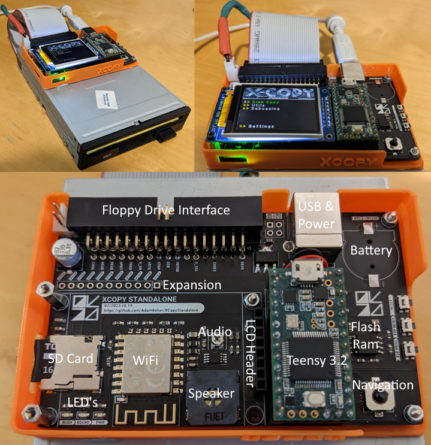
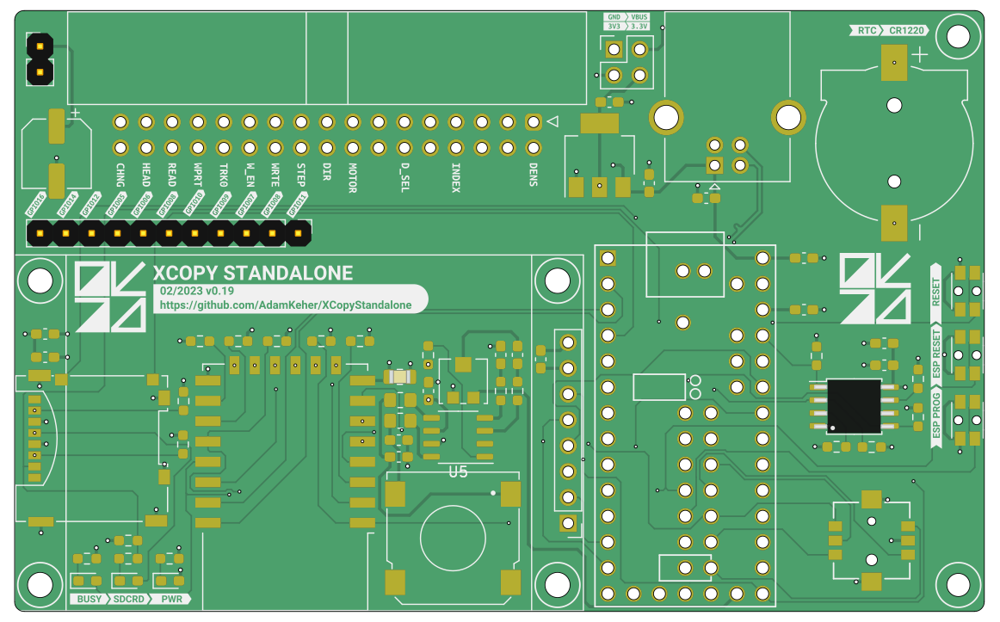
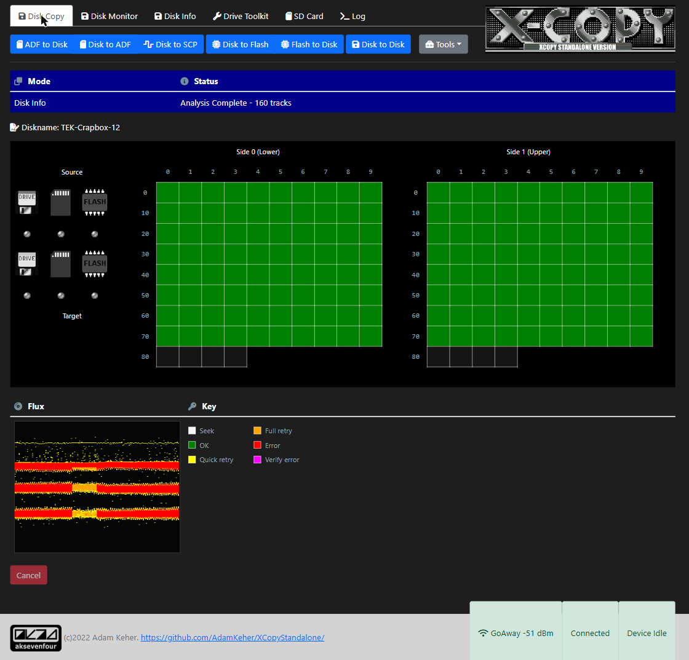
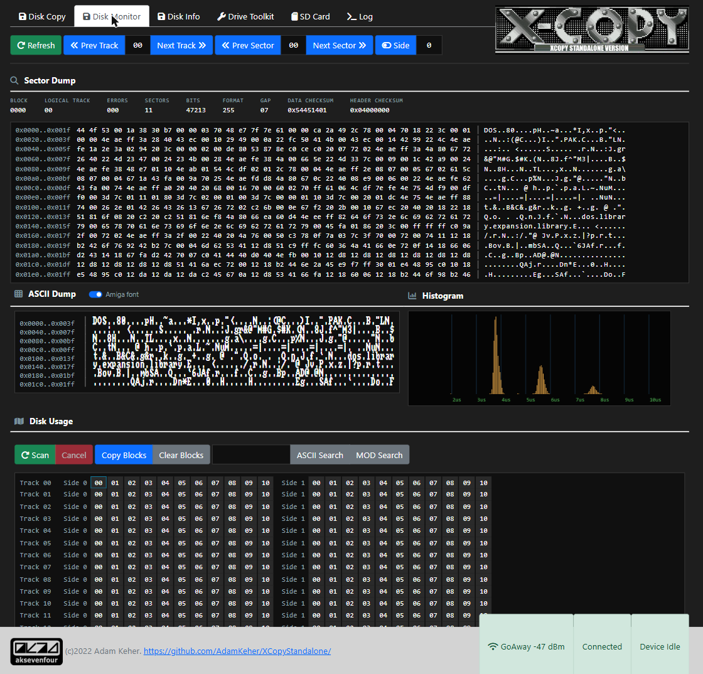
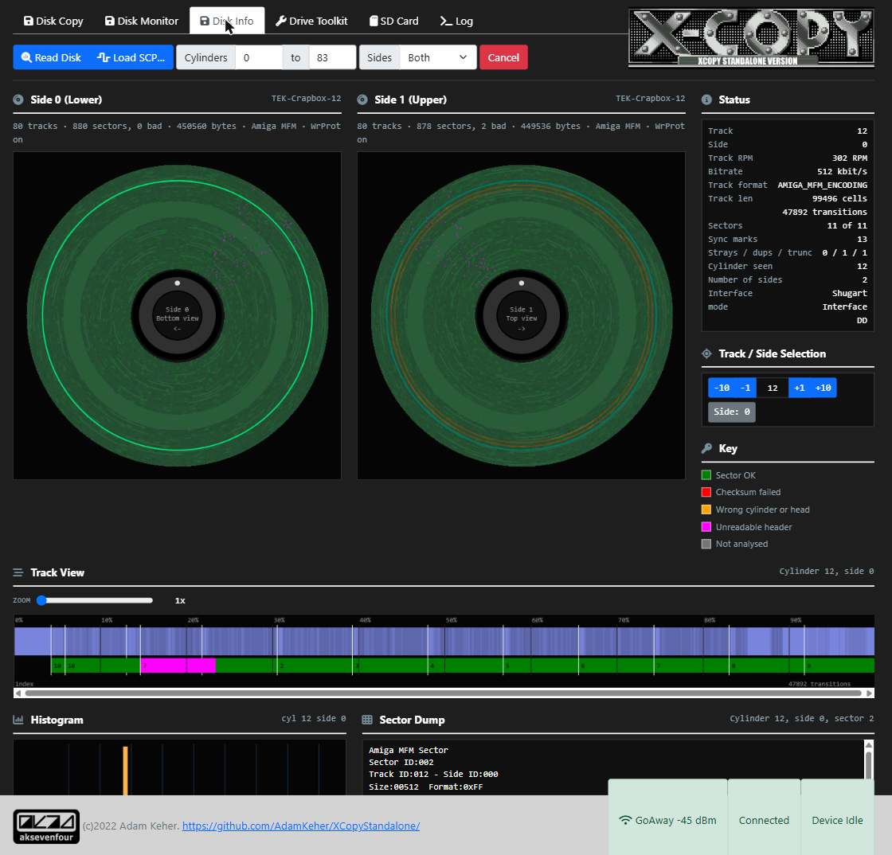
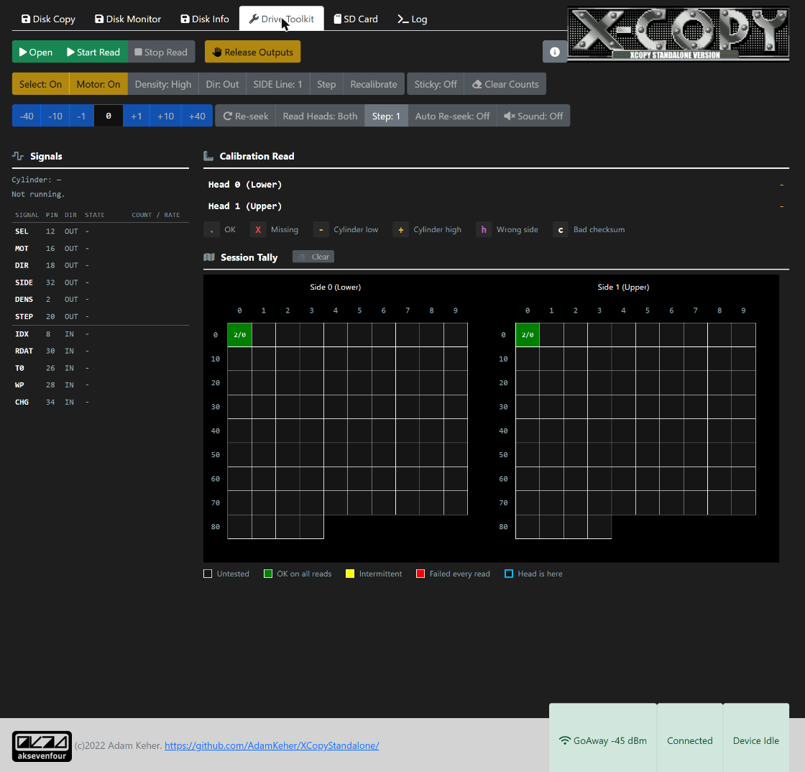
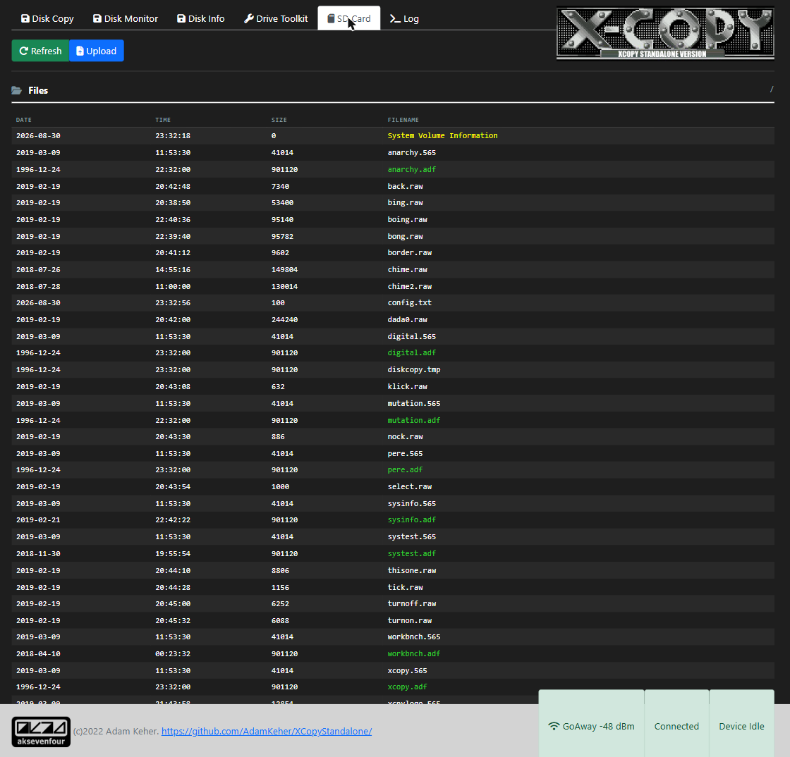
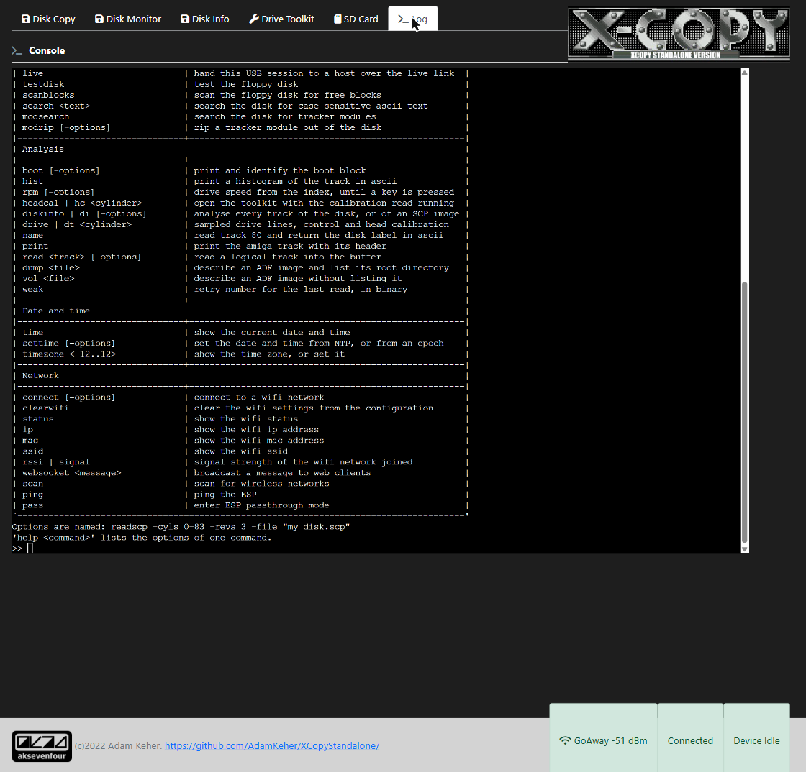

# XCopy Standalone
An Arduino / Teensy based version of the Amiga XCopy application for copying floppy disks to and from ADF files. Built for the Teensy 3.2 using a custom PCB and an unmodified PC 3.5" floppy disk drive.

### Note
XCopy Standalone liberally uses floppy interface code taken from the excelent and generously open source ADF-Copy by Dominik Tonn. 
https://nickslabor.niteto.de/download/
Nicks software uses usb serial and a Java client or a MTP connection via usb to transfer data. XCopy Standalone focuses on a standalone unit using SD card storage and a LCD and / or web sockets interface for control.

### Thanks
Special thanks to Giants for all his help with this version including web interface graphics, documentation, suggestions etc.

## Device



## Status
This project is under heavy development and is in a state of flux with new hardware and software being actively worked on. The firmware version lives in `src/XCopy/XCopy.h`; this README describes v743.26.

## New Features - 09/2026

Since the 04/2023 release the device has grown a flux layer under the copier, a
second file system layer over the SD card, and a rebuilt web interface.

* **Disk Info** - a track analyser that describes what is on a disk rather than
  copying it. One pass per track, no retries, so a protected track with the wrong
  cylinder in its headers, a track with no sectors at all, or a disk with 84
  cylinders instead of 80 is the output rather than an error. Draws both surfaces
  as disks, a flux interval histogram per track, an angular track view you can
  point at, and the decoded sector under the pointer. Runs against the drive, or
  replays an SCP image through the same decoder.
* **Drive Toolkit** - a bench instrument for bringing up an unknown drive. Every
  interface line sampled with state, counts and rates; the safe outputs drivable
  one at a time, so a drive can be provoked into saying which fault it has; and a
  continuous head calibration read, after Amiga Test Kit's, that reports how many
  of the eleven sectors came back clean and whether the ones that did not came
  from the cylinder either side. Write data and write enable are deliberately not
  exposed.
* **SuperCard Pro flux images** - `readscp` captures a disk to an SCP file,
  streamed a block at a time because a single DD revolution is larger than the RAM
  on the whole part. A matching reader replays one back through the analyser.
* **Live USB flux streaming** - `live` hands the USB session to a host that does
  its own decoding, with non blocking in band seeking so the capture ring is still
  draining during a head move. Host side probe in `files/Tools/xcopylive_probe.py`.
* **ADF images as volumes** - mount ADF files as `ADF0:` and `ADF1:`, and the disk
  in the drive itself as `DF0:`, then use `dir`, `cat`, `cp`, `mkdir` and `rm`
  across the card and any mounted image. Mounts are read only unless asked
  otherwise. ADFlib upgraded to 0.10.7, with drivers rather than local edits.
* **New serial console** - a table driven interpreter with grouped help, per
  command options, tab completion and history, in place of the hand written parser.
* **Rebuilt web interface** - six tabs over one set of shared tokens and
  components, with the Disk Monitor histogram and the Disk Info analysis streamed
  to the browser as they are produced rather than gathered first.
* **Over the air updates** - firmware and web assets over Wi-Fi, no cable needed.
* **A name on the network** - the device calls itself `xcopy` to DHCP, to mDNS and
  to OTA.
* **Host side tests** - the `native` and `native_adf` environments run the file
  system and console tests off the board.

## New Features - 04/2023
* v0.19 PCB released with intergrated ESP8266 for WiFi
  * Moved to Kicad from Eagle
  * Changed SD Card to MicroSD reader
  * Added WiFi
  * Connected USB serial to Teensy USB serial
  * Moved TFT to cheap chinese Adafruit knock off, this has changed the pinout
    * https://www.aliexpress.com/item/4001144194129.html
    * USD $1.89!
  * Moved navigation stick to cheap chinese item from LCSC
  * Additional 3.3v power regulator to relieve Teensy's
  * Added larger electrolytic cap for floppy power
  * Switced to four layer board as they are cheap and provide better power / ground planes
* Project code moved from Arduino to ProjectIO with all libraries preinstalled
* New web interface
* Amiga module ripper
* Bootblock library / virus checker using brainfile format
* Web based disk monitor
* Network NTP time update
* Upload and download ADF files via web interface

## Features
* Software
  * Disk copy
    * Disk to SD Card
    * SD Card to Disk
    * Disk to Disk
    * Disk to Temporary Flash
    * Temporary Flash to Disk
  * Flux
    * Read a disk to a SuperCard Pro (SCP) flux image
    * Analyse a disk, or an SCP image, track by track
    * Flux interval histograms, per track and live during a copy
    * Stream a live drive to a host over USB for off board decoding
  * File systems
    * Amiga file system support for floppy disks and ADF files via ADFlib 0.10.7
    * Mount ADF images as `ADF0:` / `ADF1:`, and the disk in the drive as `DF0:`
    * List, print, copy, make and remove across the card and mounted images
  * Drive diagnostics
    * Every interface line sampled, with state, counts and rates
    * Individually drivable outputs for provoking a fault out of a drive
    * Continuous head calibration read with a live per cylinder tally
    * Drive speed from the index
  * Test disk
  * Format disk
  * Search a disk for case sensitive ascii text, or for tracker modules
  * Amiga module ripper
  * Bootblock library / virus checker using brainfile format
  * Serial command line, table driven, with tab completion and history
  * Interfaces
    * TFT LCD
    * USB Serial
    * HTML over WebSockets
  * Network
    * Over the air firmware and web asset updates
    * NTP time update and time zone
    * Announces itself as `xcopy` to DHCP, mDNS and OTA
  * Serial passthrough for programming onboard ESP8266
* Hardware
  * IDC 34 pin standard floppy drive cable interface
  * 1.8" ST7735R 128x160, 18bit color LCD
  * 5 way navigation joystick
  * Mono PAM8302 amplifier with adjustable Pot
    * Onboard mounted speaker
  * SD Card reader
  * 128MBit Flash Rom with built in ADF files
  * CR1220 battery backed realtime clock
  * ESP8266 for websockets driven interface
  * Single USB plug for serial and to power floppy and Teensy 3.2
  * Status LED's
  * Additional 3.3v power regulator
  * Gerbers, schematic and pcb layout files available 

# PCB



# Web Interface

Six tabs over one WebSocket connection to the ESP8266. The footer carries the
signal strength, the link state and what the device is doing, on every tab.

### Disk Copy

Every copy path in one place - between the drive, the SD card, the onboard flash,
and an ADF or SCP file on the card - over a live track map of both surfaces and a
rolling flux view of the track being read.



### Disk Monitor

A sector at a time: the decoded header, a hex dump, an ascii dump in either the
browser font or the Amiga one, and the track's flux histogram. Below them a block
scan of the whole disk, with ascii and tracker module searches, and blocks that
can be selected and written out to the card.



### Disk Info

The analyser. Both surfaces drawn as disks with every sector coloured by what was
found there, a status panel for the selected track, an angular track view of the
raw cell stream against the sectors decoded out of it, the flux histogram, and the
decoded sector under the pointer.



### Drive Toolkit

The drive itself rather than the disk in it. Sampled interface lines down the
left, the calibration read across the top, and a session tally that accumulates
per cylinder and head - so an intermittent read shows up as intermittent rather
than as one bad pass.



### SD Card

The contents of the card, with upload and download.



### Log

The serial console in the browser - the same interpreter, the same commands and
the same output as the USB port.



# Build Environment Notes:

## VSCode Plugins:
1. PlatoformIO with Teensy & ESP8266 board 
2. Todo+ v4.18.4 by Fabio Spampinato

* Xcopy.h contains PCBVERSION define to target firmware builds to different PCB versions

## ESP8266 Build Notes:
1. Select the `d1_mini` environment (both boards are environments of this one project)
2. Plugin XCopyStandalone device and select "Debugging >> ESP >> ESP Programming Mode"
3. Set serial port to the Teensy port, the device will passthrough serial data to the ESP8266 program
4. Upload code, then upload the web assets with the `d1_mini` "Build Filesystem Image" and "Upload Filesystem Image" tasks

### Over the air

Once the ESP is on your network it can be updated over Wi-Fi instead, using the
`d1_mini_ota` environment - both the firmware and the web assets:

```shell
pio run -e d1_mini_ota -t upload      # firmware
pio run -e d1_mini_ota -t uploadfs    # web interface
pio run -e d1_mini_ota -t uploadall   # both, firmware first
```

`uploadall` is a task of this project rather than of PlatformIO, and it waits
between the two because each upload reboots the ESP.

Use `uploadfs` for the web assets, not `uploadfsota`. The platform decides
whether espota is offering a sketch or a filesystem image by matching the target
name exactly, and `uploadfsota` misses that test - so the image goes over as a
sketch, is measured against the 1MB sketch region instead of its own 2MB
partition, and is refused with `ERROR[4]: Not Enough Space`. `scripts/
espota_fs_flag.py` puts the missing flag back, so both targets now work.

The device calls itself `xcopy` to the DHCP server, to mDNS and to OTA, so it is
reachable by whichever name your network gives it. `upload_port` in
`platformio.ini` is set to `xcopy.lab` - change it to `xcopy.local` to go via
mDNS instead, or to a bare IP address if neither resolves from your machine.

The serial passthrough above is unchanged and remains the way back in if an
update ever leaves the ESP unable to join a network.
5. Select "Debugging >> ESP >> Reset ESP"
6. Open a serial terminal
7. Connect to your wireless access point using the connect command
```shell
>> connect SSIDName Password
```
8. Type the following commands to confirm you have connected
```shell
>> status
WiFi Status: Connected
-----
Mode: STA
PHY mode: N
Channel: 10
AP id: 0
Status: 5
Auto connect: 1
SSID (6): SSIDName
Passphrase (12): Password
BSSID set: 0
>> ip
192.168.X.XX
>> ssid
SSIDName
>>
```

## Project layout

Both firmwares are environments of a single PlatformIO project, so the IDE lists
them in one Project Tasks tree and `pio run` with no arguments builds the pair.

| | |
|---|---|
| `src/` | Teensy 3.2 firmware, built by the `teensy31` environment |
| `src/esp8266/` | ESP8266 firmware, built by the `d1_mini` environment |
| `esp8266/data/` | web interface, uploaded to the ESP as a LittleFS image |
| `shared/` | the Teensy to ESP link contract, compiled into both |
| `lib/` | libraries for both; `esp8266/lib/` holds the ESP only ones |

Both boards are environments of the one project: `teensy31`, `d1_mini`, and
`d1_mini_ota` for updating the ESP over Wi-Fi. Two more, `native` and
`native_adf`, build nothing for a board and exist to run the console and file
system tests on the host.

Neither firmware is a `.ino` sketch: PlatformIO only converts a sketch sitting at
the top of the source directory, and with two source trees neither one can be.

## How to build PlatformIO based project

1. [Install PlatformIO Core](http://docs.platformio.org/page/core.html)
2. Download [development platform with examples](https://github.com/platformio/platform-teensy/archive/develop.zip)
3. Open the project
4. Pick the environment you want - `teensy31` or `d1_mini` - or build both at once
5. Select 'PlatformIO:Build'
6. Select 'PlatformIO:Upload'
